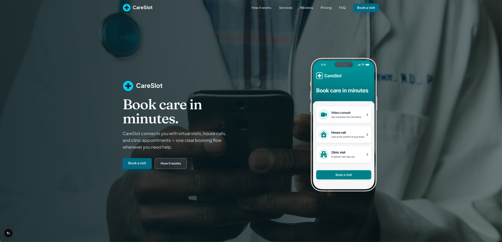

# CareSlot — Telehealth Booking Landing Page

Modern **Next.js** portfolio landing page for a fictional telehealth / e-channeling product.

Users can explore how to book **video consults**, **house calls**, and **clinic visits** from one clear booking experience.

> **Demo only.** CareSlot is not a real medical service and is not affiliated with any clinic or previous client project.

## Preview



*Hero: CareSlot brand, “Book care in minutes.”, dual CTAs, and floating app mockup over a full-bleed clinical photo.*

## Features

- Sticky header with logo, anchor navigation, and primary **Book a visit** button  
- Full-bleed hero with brand-first layout (logo + headline + short pitch + CTAs + phone UI mockup)  
- **How it works** — switch between video, home visit, and clinic steps with images  
- **Services** — telehealth platform, house calls, and clinic visits  
- **Reviews** — four sample customer quotes  
- **Pricing** — three sample plans (Video consult highlighted as most popular)  
- **FAQ** accordion + demo waitlist email form (client-side only)  
- Responsive layout for desktop and mobile  
- Light motion with Framer Motion (hero entrance + scroll reveals)

## Services (product concept)

| Service | What it is | Sample price (demo) |
|--------|------------|---------------------|
| **Video consult** | Audio/video + messaging with a licensed provider | $25 / consultation |
| **House call** | Clinician visits your preferred location | $80 / visit |
| **Clinic visit** | In-person booking at a partner center | $10 booking fee |

Prices are illustrative only and are not charged on this site.

## Tech stack

| Layer | Choice |
|-------|--------|
| Framework | Next.js 16 (App Router) |
| Language | TypeScript |
| Styling | Tailwind CSS v4 |
| Motion | Framer Motion |
| Fonts | Plus Jakarta Sans (UI), Fraunces (headlines) via `next/font` |
| Images | `next/image` + assets in `public/` |

## Getting started

**Requirements:** Node.js 20+ and npm.

```bash
# Install dependencies
npm install

# Start local dev server
npm run dev
```

Open [http://localhost:3000](http://localhost:3000).

### Other scripts

```bash
npm run build   # Production build
npm start       # Serve the production build
npm run lint    # Run ESLint
```

## Project structure

```
careslot-landing/
├── app/
│   ├── layout.tsx       # Fonts, metadata, root shell
│   ├── page.tsx         # Home page (section composition)
│   └── globals.css      # Brand tokens + Tailwind
├── components/
│   ├── Header.tsx       # Sticky nav + mobile menu
│   ├── Hero.tsx         # Full-bleed hero + phone mockup
│   ├── HowItWorks.tsx   # Tabbed steps
│   ├── Services.tsx
│   ├── Reviews.tsx
│   ├── Pricing.tsx
│   ├── Faq.tsx          # Accordion + waitlist form
│   ├── Footer.tsx
│   ├── Logo.tsx
│   └── Reveal.tsx       # Scroll-in animation helper
├── public/
│   ├── home_page.png    # README preview screenshot
│   ├── careslot-phone-ui.png
│   ├── hero-bg.jpg
│   ├── how-1.jpg … how-3.jpg
│   ├── logo.svg
│   └── favicon.svg
├── package.json
└── README.md
```

## Brand guidelines (demo)

| Token | Value | Use |
|-------|-------|-----|
| Teal | `#0E7490` | Primary buttons, accents |
| Teal deep | `#0F5F75` | Hover / emphasis |
| Mint | `#ECFEFF` | Soft section backgrounds |
| Ink | `#0F172A` | Body text on light sections |
| Display font | Fraunces | Headlines |
| UI font | Plus Jakarta Sans | Nav, body, buttons |
